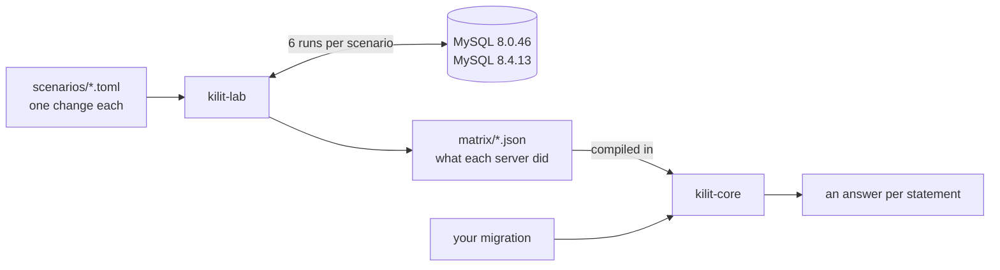

<div align="center">

# kilit

**Know what MySQL will do with your migration before you deploy it.**

[](#license)
[](https://www.rust-lang.org)
[](Cargo.toml)
[](#what-mysql-does-with-common-changes)
[](#roadmap)

[Why](#why) · [Example](#example) · [Findings](#what-mysql-does-with-common-changes) · [Getting started](#getting-started) · [How it works](#how-it-works) · [Roadmap](#roadmap)

</div>

kilit reads a schema migration and tells you, statement by statement, what
MySQL will do with it: change only the table's metadata, work on the table in
place, or copy every row into a new table, and whether writes keep flowing
while it runs. Give it your schema as well and it follows your tables through
the migration, so it can judge `->change()` too. Every answer comes from
measurements on real MySQL servers, not from guesses.

*kilit* is Turkish for *lock*.

## Why

Some schema changes are free. Others make MySQL copy the whole table while
every write to it waits, and the migration looks the same either way. This one
line of Laravel:

```php
$table->foreignId('user_id')->constrained();
```

adds a column instantly, then copies every row of the table to add the foreign
key. On a large table, that means writes waiting for minutes in production.

MySQL documents the rules, but the answer depends on the server version, the
table and the data. A FULLTEXT index elsewhere on the table, a row that breaks
the new constraint, or a VARCHAR that grows past 255 bytes can each turn a
cheap change into a table copy or a failed deploy. kilit does not reason from
the documentation: a lab runs each kind of change against real servers and
records what they did, and kilit answers from those records.

## Example

With the schema that `php artisan schema:dump` writes for a small Laravel
app, and a migration on its `orders` table:

```text
$ cargo run -p kilit-core --example check
checked against mysql-8.4.13, as measured by kilit-lab
tables from mysql-schema.sql: migrations, orders, shops, users

line 9: alter table `orders` modify `amount` bigint not null
  COPY, copies every row, writes wait
  measured as change-integer-type (3 lab scenarios)
  - changes the type from INT to BIGINT
  - if a value does not fit the new type (in strict SQL mode, the default): fails with error 1264 (int-to-tinyint-out-of-range)

line 16: alter table `orders` modify `status` varchar(30) not null
  UNKNOWN: 2 changes in one statement. kilit has measured them one at a time, and MySQL picks one algorithm for the whole statement, which can be heavier than each change alone:
    - changes VARCHAR(20) to VARCHAR(30), 80 to 120 bytes in utf8mb4
    - drops the default 'new'

line 19: alter table `orders` modify `user_id` int unsigned not null
  fails with error 3780
  measured as change-integer-type (1 lab scenario)
  - changes the type from BIGINT UNSIGNED to INT UNSIGNED
  - user_id is in the foreign key orders_user_id_foreign; assumes foreign_key_checks is ON, the MySQL default: nothing before this statement sets it

line 25: alter table `orders` add fulltext `orders_note_fulltext`(`note`)
  INPLACE, rebuilds the table, writes wait
  measured as add-fulltext-index (1 lab scenario)

line 28: alter table `orders` add `channel` varchar(255) null
  COPY, copies every row, writes wait
  measured as add-column (1 lab scenario)
  - orders has the FULLTEXT index orders_note_fulltext
```

Line 16 is `$table->string('status', 30)->change()`. Since Laravel 11,
`->change()` replaces the whole column definition, so a modifier the call does
not repeat, here `->default('new')`, is dropped. Line 28 adds a column the way
line 6 did, and that one was instant; the FULLTEXT index added on line 25
turns it into a table copy.

Every statement gets one of three answers:

- **A measured verdict:** the algorithm MySQL picks, whether it rebuilds or
  copies the table, and whether writes continue, with the lab scenarios behind
  it. Notes say what kilit worked out, and list measured situations that
  change the answer but that no schema shows, such as the rows in the table.
- **Unknown,** with the reason. kilit never reports a change it has not
  measured as safe.
- **Not checked,** for statements that are not schema changes, such as
  `INSERT` or `SET`. Session settings like `foreign_key_checks` are still
  followed into the statements after them.

## What MySQL does with common changes

Measured with kilit-lab on MySQL 8.0.46 and 8.4.13, on a table of 1,000 rows.
Both versions behave the same in every scenario.

### Columns, indexes and foreign keys

| Change | MySQL does | Writes |
| --- | --- | --- |
| Add a column¹<br>`$table->string('coupon')->nullable()` | INSTANT | continue |
| ↳ when the table has a FULLTEXT index | COPY, copies every row | **wait** |
| ↳ after 64 instant column changes | INPLACE, rebuilds the table | continue |
| Drop a column<br>`$table->dropColumn('note')` | INSTANT | continue |
| ↳ when the table has a FULLTEXT index | COPY, copies every row | **wait** |
| Rename a column<br>`$table->renameColumn('note', 'memo')` | INSTANT | continue |
| Set a column default<br>`ALTER COLUMN … SET DEFAULT` (raw SQL) | INSTANT | continue |
| Add an index<br>`$table->index('amount')` | INPLACE | continue |
| Add a unique index<br>`$table->unique('email')` | INPLACE | continue |
| ↳ when values repeat | fails, error 1062 | – |
| Add a FULLTEXT index<br>`$table->fullText('note')` | INPLACE, rebuilds the table | **wait** |
| Drop an index<br>`$table->dropIndex('orders_amount_index')` | INPLACE | continue |
| Add a foreign key<br>`$table->foreign('user_id')->references('id')->on('users')` | COPY, copies every row | **wait** |
| ↳ when a row points to a missing parent | fails, error 1452 | – |
| ↳ with the checks off²<br>`Schema::disableForeignKeyConstraints()` | INPLACE | continue |
| Drop a foreign key<br>`$table->dropForeign(['user_id'])` | INPLACE | continue |

¹ Seven ways of adding a column were measured, and all are INSTANT: nullable,
`NOT NULL` with and without a default, `AFTER`, `FIRST`, with a character set,
collation and comment, and a `TIMESTAMP` defaulting to `CURRENT_TIMESTAMP`.\
² Even when a row points to a missing parent: the foreign key is added, and the
row stays as it is, unchecked.

### Changing a column with `->change()`

Laravel turns `->change()` into `MODIFY`, which replaces the column's whole
definition. kilit compares it with the column's current definition, from your
schema, and answers for what actually changes.

| Change | MySQL does | Writes |
| --- | --- | --- |
| Change between integer types³<br>`$table->bigInteger('amount')->change()` | COPY, copies every row | **wait** |
| ↳ when the column is in a foreign key | fails, error 3780 | – |
| ↳ when a value does not fit the new type | fails, error 1264 | – |
| Lengthen a VARCHAR within 255 bytes⁴<br>`$table->string('note', 63)->nullable()->change()` | INPLACE | continue |
| Lengthen a VARCHAR past 255 bytes⁴<br>`$table->string('note', 64)->nullable()->change()` | COPY, copies every row | **wait** |
| Shorten a VARCHAR<br>`$table->string('note', 40)->nullable()->change()` | COPY, copies every row | **wait** |
| ↳ when a value is longer than the new length | fails, error 1265 | – |
| Change the character set⁵<br>`$table->string('note', 50)->charset('latin1')->nullable()->change()` | COPY, copies every row | **wait** |
| Change the collation<br>`$table->string('note', 50)->collation('utf8mb4_bin')->nullable()->change()` | INPLACE | continue |
| ↳ when the column is in an index | COPY, copies every row | **wait** |
| Make a column nullable<br>`$table->integer('amount')->nullable()->change()` | INPLACE, rebuilds the table | continue |
| Make a column NOT NULL<br>`$table->string('email')->nullable(false)->change()` | INPLACE, rebuilds the table | continue |
| ↳ when a row holds NULL | fails, error 1138 | – |
| Give, change or drop a default<br>`$table->integer('amount')->default(0)->change()` | INSTANT | continue |
| Move a column<br>`$table->string('note', 50)->nullable()->after('user_id')->change()` | INPLACE, rebuilds the table | continue |
| Rename a column with `CHANGE`<br>`$table->renameColumn()` before MySQL 8.0.3 | INSTANT | continue |
| Keep the same definition<br>`->change()` with nothing new | INSTANT | continue |

³ `INT` to `BIGINT`, to `SMALLINT` and to `INT UNSIGNED`.\
⁴ In `utf8mb4` a character takes up to 4 bytes, so `VARCHAR(63)` is 252 bytes
and `VARCHAR(64)` is 256; in `latin1`, one byte each. Past 255 bytes, MySQL
stores each value's length in 2 bytes instead of 1. Both edges were measured
in both character sets.\
⁵ Including a `MODIFY` that names no character set on a column whose set
differs from the table's: the column takes the table's, and MySQL copies the
table to convert it.

INSTANT changes only the table's metadata. INPLACE works on the existing
table; where it rebuilds the table, it rewrites every row, which takes time on
a large table even while writes continue. COPY builds a new table and copies
every row into it. Writes **wait** when the server refuses `LOCK=NONE` for the
change: inserts, updates and deletes on the table wait until it finishes.

Every row comes from a scenario in [`scenarios/`](scenarios/) and its results
in [`matrix/`](matrix/).

## Getting started

You need [Rust](https://rustup.rs) 1.88 or newer. Checking a migration needs no
database: the lab's results are compiled into kilit.

```sh
git clone https://github.com/Veysel440/kilit.git
cd kilit

# the sample migration, on the sample tables in crates/kilit-core/examples/
cargo run -p kilit-core --example check

# your own migration and schema, against MySQL 8.4.13 (the default) or 8.0.46
cargo run -p kilit-core --example check -- --schema path/to/mysql-schema.sql path/to/migration.sql
cargo run -p kilit-core --example check -- --schema path/to/mysql-schema.sql path/to/migration.sql mysql-8.0.46
```

In a Laravel project, `php artisan schema:dump` writes the schema to
`database/schema/mysql-schema.sql`, and `php artisan migrate --pretend` prints
the statements your migrations will run; save those to a file. kilit reads
plain SQL for now; reading the `--pretend` output directly is on the
[roadmap](#roadmap). Without `--schema`, kilit still answers everything that
does not depend on the table, and says so where it does.

### Running the lab

The lab needs Docker with Compose.

```sh
docker compose up -d --wait          # MySQL 8.0.46 on port 3380, 8.4.13 on port 3384
cargo run -p kilit-lab               # a summary per server; results go to matrix/
cargo run -p kilit-lab -- --details  # also every variant of every scenario
docker compose down                  # remove the servers
```

> [!WARNING]
> The lab drops and recreates a database named `kilit_lab`. Only point it at
> throwaway servers.

## How it works



**The lab** (`kilit-lab`) starts every scenario from the same two tables,
`users` and `orders`, and runs its change six ways: as written, then with
`ALGORITHM=INSTANT`, `ALGORITHM=INPLACE`, `ALGORITHM=INPLACE, LOCK=NONE`,
`ALGORITHM=COPY` and `LOCK=NONE`. For each run it records whether the server
accepted the statement or which error it returned, how many rows it copied,
whether InnoDB rebuilt the table, and InnoDB's count of instant column changes.
From the six runs it derives a verdict: the algorithm the server picks when
nothing is forced, checked against the run as written, whether the table is
rebuilt or copied, and whether writes can continue. The results go to
`matrix/`, one JSON file per server version. They hold no timestamps or ids, so
a file changes only when a server behaves differently, and the lab reports
which scenarios changed.

**The reader** splits SQL into statements, so a semicolon inside a string or a
comment does not end one, and reads each statement with
[sqlparser](https://crates.io/crates/sqlparser)'s MySQL dialect into kilit's
own types. Nothing is dropped silently: an operation it reads but does not model
becomes `Other`, and a statement it cannot read becomes `Unparsed` without
stopping the statements after it.

**The schema** comes from `CREATE TABLE` statements, such as a schema dump.
kilit follows every statement of the migration through it: columns, indexes and
foreign keys are added, changed, renamed and dropped, so each statement is
judged against the tables as they are at that point. When a statement changes a
table in a way kilit cannot follow, such as one it cannot read, kilit stops
trusting what it knew about that table instead of guessing.

**The checker** places each change in a *case*: a kind of change, together with
the lab scenarios that measured it. For a `MODIFY` or `CHANGE`, kilit compares
the new definition with the column's current one, character set and collation
included, and the one thing that changes decides the case. The scenarios of a
case must agree on every server, or kilit refuses to answer. A case can also
have *exceptions*: the same change measured in a situation where the answer
differs. When the situation shows in the schema, such as a FULLTEXT index on the
table or a foreign key on the column, it decides the answer; when it does not,
such as rows that break a new constraint, it becomes a note. A statement that
forces `ALGORITHM=...` or `LOCK=NONE` is answered from the lab's run of exactly
that variant.

## Design principles

- **Measured, not guessed.** Every answer names the lab scenarios behind it.
  A golden test runs the scenarios of every case through kilit, in all six
  variants and on both servers, and fails if kilit's answer differs from what
  the server did.
- **Never silently safe.** A statement kilit cannot read, a change it has not
  measured, or several changes in one statement are reported as unknown, with
  the reason.
- **Reproducible.** Running the lab again changes a result file only when a
  server behaves differently. The lab also checks the few facts kilit uses
  without a scenario of their own, such as how many bytes a character takes
  in each character set.
- **Pure Rust.** No C or assembly is compiled anywhere in the dependency tree,
  and `unsafe` code is forbidden in the workspace.
- **No I/O in the core.** `kilit-core` takes text and returns data. The lab's
  results are compiled into it, so checking needs no database.

## Limitations

kilit is young, and it says so when it does not know. Today:

- `MODIFY` and `CHANGE` need the table's current definition: without a
  schema, kilit lists what the lab measured instead of answering.
- A statement with several changes, including a `MODIFY` that changes several
  things about a column, is reported as unknown; the lab has measured single
  changes only.
- Type changes other than between integer types, such as `VARCHAR` to `TEXT`,
  are not measured yet.
- Only MySQL 8.0.46 and 8.4.13 are measured. MariaDB is not supported.
- sqlparser 0.63 cannot read `CONVERT TO CHARACTER SET`, `ENGINE=...`,
  `RENAME INDEX`, `ALGORITHM=NOCOPY` or `OPTIMIZE TABLE` yet, so kilit reports
  them as unreadable.
- "Writes continue" describes the change itself. Every `ALTER TABLE`, even an
  instant one, briefly needs an exclusive metadata lock on the table. If a long
  transaction is using the table, the `ALTER` waits for it, and new queries on
  the table queue up behind the `ALTER`. kilit does not warn about this yet.

## Roadmap

- [x] A lab that measures schema changes on MySQL 8.0 and 8.4 and keeps
  reproducible results
- [x] A reader for MySQL migrations, including the SQL Laravel generates
- [x] Measured answers for column, index and foreign key changes, following
  session settings such as `foreign_key_checks`
- [x] Schema awareness: answers for `MODIFY` and `CHANGE` from the column's
  current definition, and definite answers for tables with a FULLTEXT index
- [ ] A `kilit check` command: Laravel's `migrate --pretend` output as input,
  JSON output, and exit codes for CI
- [ ] Continuous integration, including a scheduled lab run that catches
  behavior changes in new MySQL releases
- [ ] A first release on crates.io

## Project layout

```text
crates/kilit-core/   reads migrations and checks them; no I/O
crates/kilit-lab/    measures schema changes on real MySQL servers
scenarios/           one TOML file per measured change, and the lab's tables
matrix/              the lab's results, one JSON file per server version
compose.yaml         the MySQL servers the lab runs against
```

## Contributing

The most valuable contribution is a new measurement. A scenario is a small TOML
file in [`scenarios/`](scenarios/):

```toml
title = "Add a FULLTEXT index"
operation = "ADD FULLTEXT INDEX ft_orders_note (note)"
```

[`scenarios/README.md`](scenarios/README.md) explains the format and the three
steps from a new file to an answer kilit gives. Before you open a pull request,
run:

```sh
cargo fmt --check
cargo clippy --all-targets -- -D warnings
cargo test
```

## License

Licensed under either of [Apache License, Version 2.0](LICENSE-APACHE) or
[MIT license](LICENSE-MIT) at your option.
