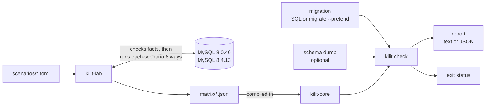
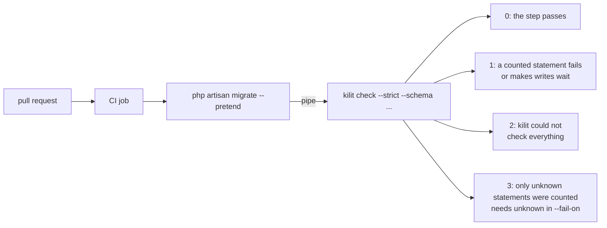
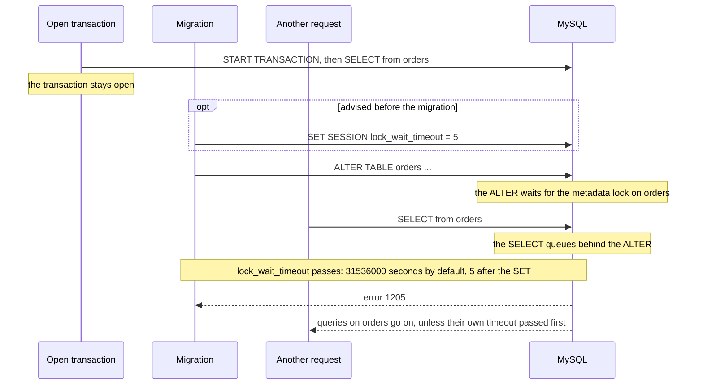

<div align="center">

# kilit

**Know what MySQL will do with your migration before you deploy it.**

[](https://github.com/Veysel440/kilit/actions/workflows/ci.yml)
[](https://github.com/Veysel440/kilit/releases)
[](#license)
[](https://www.rust-lang.org)
[](Cargo.toml)
[](docs/findings.md)

[Why](#why) · [Example](#example) · [How it works](#how-it-works) · [Installation](#installation) · [Usage](#usage) · [In CI](#in-ci)<br>
[Findings](#measured-behavior-at-a-glance) · [Metadata lock](#the-metadata-lock) · [Limitations](#assumptions-and-limitations) · [Principles](#design-principles) · [Related tools](#related-tools) · [Contributing](#contributing)

</div>

kilit reads a schema migration and tells you, statement by statement, what
MySQL will do with it: change only the table's metadata, work on the table in
place, or copy every row into a new table, and whether writes keep flowing
while it runs. It reads plain SQL or the output of `php artisan migrate
--pretend`. Give it your schema as well and it follows your tables through the
migration, so it can judge `->change()` too. Every answer comes from
measurements on real MySQL servers, not from guesses, and the exit status can
stop a deploy that would make writes wait. *kilit* is Turkish for *lock*.

## Why

Some schema changes are free. Others make MySQL copy the whole table while
every write to it waits, and the migration looks the same either way. This one
line of Laravel:

```php
$table->foreignId('user_id')->constrained();
```

adds a column instantly, then copies every row of the table to add the foreign
key. On a large table, writes wait for minutes. The answer depends on the
server version, the table and the data, so kilit does not reason from the
documentation: a lab runs each kind of change on real servers, and kilit
answers from its records.

## Example

Six pending migrations of a small Laravel app, piped from `migrate --pretend`
into kilit with the app's schema. kilit names one of three ways MySQL runs a
change:

- **INSTANT** changes only the table's metadata.
- **INPLACE** works on the existing table.
- **COPY** builds a new table and copies every row.

Four of the migrations:

```text
$ php artisan migrate --pretend | kilit check --schema database/schema/mysql-schema.sql
checked against mysql-8.4.13, as measured by kilit-lab
tables from database/schema/mysql-schema.sql: 4 (migrations, orders, shops, users)

2026_11_02_090100_widen_amount_on_orders_table
  alter table `orders` modify `amount` bigint not null
    COPY, copies every row, writes wait
    measured as change-integer-type (6 lab scenarios)
    - changes the type from INT to BIGINT
    - if a value does not fit the new type (in strict SQL mode, the default): fails with error 1264 (int-to-tinyint-out-of-range)

2026_11_02_090200_add_shop_to_orders_table
  alter table `orders` add `shop_id` bigint unsigned null
    INSTANT, no rebuild, writes continue
    measured as add-column (17 lab scenarios)
    - if the table has had 64 instant column changes since it was last rebuilt, or a FULLTEXT index that was dropped since then: INPLACE, rebuilds the table, writes continue (add-column-after-64-changes, add-column-after-dropping-fulltext)
  alter table `orders` add constraint `orders_shop_id_foreign` foreign key (`shop_id`) references `shops` (`id`)
    COPY, copies every row, writes wait
    measured as add-foreign-key (22 lab scenarios)
    - assumes foreign_key_checks is ON, the MySQL default: nothing before this statement sets it
    - if a row points to a parent row that does not exist: fails with error 1452 (add-foreign-key-orphans)

2026_11_02_090300_create_order_events_table
  create table `order_events` (`id` bigint unsigned not null auto_increment primary key, `order_id`...
    not checked: creates a new table; no existing rows are touched
  alter table `order_events` add constraint `order_events_order_id_foreign` foreign key (`order_id`) references `orders` (`id`) on delete cascade
    COPY, copies every row, writes wait
    measured as add-foreign-key (22 lab scenarios)
    - assumes foreign_key_checks is ON, the MySQL default: nothing before this statement sets it
    - order_events is created earlier in these migrations: nothing else uses it yet, so nothing waits for it

2026_11_02_090400_lengthen_status_on_orders_table
  alter table `orders` modify `status` varchar(30) not null
    UNKNOWN: 2 changes in one statement. kilit has measured them one at a time, and MySQL picks one algorithm for the whole statement, which can be heavier than each change alone:
      - changes VARCHAR(20) to VARCHAR(30), 80 to 120 bytes in utf8mb4
      - drops the default 'new'

metadata lock on orders:
  Every ALTER TABLE, DROP TABLE, RENAME TABLE and TRUNCATE TABLE first waits
  for the open transactions that have used any of its tables to end. While it
  waits, new queries on those tables queue behind it, reads too, even for an
  INSTANT change, and by default MySQL lets it wait a year (lock_wait_timeout
  = 31536000). Run SET SESSION lock_wait_timeout = 5 before the migration to
  cap the wait: the statement then fails with error 1205 after 5 seconds, the
  queries behind it go on, and you can run the migration again later.
  measured by kilit-lab on mysql-8.4.13

8 statements: 3 make writes wait, 1 unknown, 2 run while writes continue, 1 changes a table created here, 1 not checked
```

- `$table->bigInteger('amount')->change()` copies the table, and writes wait.
- `$table->foreignId('shop_id')->nullable()->constrained()` is two
  statements: an instant column, then a foreign key that copies the table. The
  key of the new `order_events` table has no rows to copy.
- `$table->string('status', 30)->change()` looks like one change. Since
  Laravel 11, `->change()` replaces the whole column definition, so the
  `->default('new')` it does not repeat is dropped too. kilit measured each
  change alone, not both together, and says so.

kilit exits with 1 here, because three statements make writes wait. Every
statement gets a **measured answer** (the algorithm, rebuild or copy, whether
writes continue, and the scenarios behind it), **UNKNOWN** with the reason, or
**not checked**: a `CREATE TABLE`, a `DROP TABLE`, a `SET`, a read or a write
of rows. kilit never calls a change safe that it has not measured safe on what
it knows of the table. On a table it does not know, it says UNKNOWN and shows
the answer the lab measured on a plain InnoDB table, the likely one. Where
every table it may be gives the same result, such as writes wait for a FULLTEXT
index, it says that.

## How it works

The lab measures each scenario on real servers and stores what they did;
`kilit check` answers from those results, which are compiled into it.



The lab runs each of 400 scenarios six ways on fresh tables. kilit follows your
tables through the migration and answers each change from the matching
measurement: [architecture](docs/architecture.md).

## Installation

Each [release](https://github.com/Veysel440/kilit/releases) has an archive for
five targets, a `SHA256SUMS` file and build provenance attestations. Checking a
migration needs no database.

| Target | For |
| --- | --- |
| `x86_64-unknown-linux-musl` | Linux on x86_64, statically linked |
| `aarch64-unknown-linux-musl` | Linux on aarch64, statically linked |
| `aarch64-apple-darwin` | macOS on Apple silicon |
| `x86_64-apple-darwin` | macOS on Intel |
| `x86_64-pc-windows-msvc` | Windows on x86_64 |

Each archive holds a folder `kilit-<version>-<target>` with the binary,
`LICENSE-MIT`, `LICENSE-APACHE` and this README. On Linux or macOS, pick your
target, then download, check and unpack it:

```sh
VERSION=0.1.0
TARGET=x86_64-unknown-linux-musl   # or another target from the table
curl -fsSLO "https://github.com/Veysel440/kilit/releases/download/v$VERSION/kilit-$VERSION-$TARGET.tar.gz"
curl -fsSLO "https://github.com/Veysel440/kilit/releases/download/v$VERSION/SHA256SUMS"
grep " kilit-$VERSION-$TARGET.tar.gz\$" SHA256SUMS | sha256sum -c -   # macOS: shasum -a 256 -c -
tar -xzf "kilit-$VERSION-$TARGET.tar.gz"
mkdir -p ~/.local/bin
install -m 755 "kilit-$VERSION-$TARGET/kilit" ~/.local/bin/kilit        # any directory on your PATH
kilit --version
```

`~/.local/bin` is not on the `PATH` by default on macOS, nor on some Linux
setups. Add it to your `PATH`, or install into another directory that is.

On Windows, download `kilit-0.1.0-x86_64-pc-windows-msvc.zip` and `SHA256SUMS`
from the Releases page, check the zip in PowerShell (it prints `True` when the
checksum matches), unpack it, and put `kilit.exe` in a folder on your `PATH`:

```powershell
(Get-FileHash .\kilit-0.1.0-x86_64-pc-windows-msvc.zip).Hash -eq ((Select-String -SimpleMatch 'kilit-0.1.0-x86_64-pc-windows-msvc.zip' SHA256SUMS).Line -split '\s+')[0]
```

The attestation says that GitHub Actions built the archive from this
repository. Check it with the [GitHub CLI](https://cli.github.com) 2.67.0 or
newer; older versions could report success when no attestation matched:

```sh
gh attestation verify "kilit-$VERSION-$TARGET.tar.gz" --repo Veysel440/kilit
```

The command needs a login: run `gh auth login`, or set `GH_TOKEN` in CI.

An archive downloaded in a browser on macOS is quarantined, and macOS refuses
to open the binary. Clear the mark on the archive before you unpack it:
`xattr -d com.apple.quarantine kilit-0.1.0-aarch64-apple-darwin.tar.gz`.
Archives downloaded with `curl` carry no mark.

To build from source instead, you need [Rust](https://rustup.rs) 1.88 or newer.
There is no package on crates.io.

```sh
git clone https://github.com/Veysel440/kilit.git
cd kilit
cargo install --locked --path crates/kilit   # puts kilit in ~/.cargo/bin
```

## Usage

In a Laravel project:

```sh
php artisan schema:dump
php artisan migrate --pretend | kilit check --schema database/schema/mysql-schema.sql
```

Run both against a database that has production's migrations applied
([why](#in-ci)). Give `--schema` every time: without it kilit does not know
the tables the migration does not create, so it answers UNKNOWN for a change a
table could make heavier (a foreign key, a MyISAM or COMPRESSED table), says
only "writes wait" where every table it may be makes them wait (a FULLTEXT
index), and the report says so once at the top. More in [the Laravel
notes](docs/laravel.md).

For SQL files or saved `--pretend` output (or standard input):

```sh
kilit check --schema schema.sql a.sql b.sql
```

Each file is a session of its own, as `mysql < a.sql` and `mysql < b.sql` are:
settings start over, and the tables carry over.

`--server` takes a release (`mysql-8.4.13`) or a series (`mysql-8.4`,
`mysql-8.0`), which means the newest release the lab measured in that series.
Without it kilit uses `mysql-8.4`, the 8.4 LTS; a new series never moves the
default. The header of every report names the exact release. `kilit servers`
lists them and marks the default.

`--schema` takes `php artisan schema:dump` or `mysqldump --no-data` output.
A table the dump does not have is a table kilit does not know.
kilit warns when its `-- Server version` line names another MySQL series. A
MariaDB dump stops kilit with exit status 2 unless you give `--server`.

## In CI

An example pipeline: the job pipes Laravel's `--pretend` output into
`kilit check`, and the CI system fails the step on any exit status other than
0.



In a GitHub Actions job, the Action installs kilit from the release:

```yaml
- uses: Veysel440/kilit@v0.1.0
- shell: bash
  run: php artisan migrate --pretend | kilit check --strict --format github --server mysql-8.4 --schema database/schema/mysql-schema.sql
```

`--strict` makes UNKNOWN stop the step too: UNKNOWN means a person must look,
and without it kilit exits 0 for a statement it cannot answer
(`--fail-on fails,waits` accepts UNKNOWN).

To pin the Action to the commit the tag points at, write `uses:
Veysel440/kilit@<commit sha> # v0.1.0`. Find the commit with `gh api
repos/Veysel440/kilit/commits/v0.1.0 --jq .sha`. A complete workflow for a
Laravel pull request, with its database service, is in
[the Action's page](docs/github-action.md).

Pass `--server` with the series of production's server (`mysql-8.4` above).
Laravel's schema dump has no `-- Server version` line, so kilit cannot warn
when the server differs; [the Action's page](docs/github-action.md) explains
why.

`migrate --pretend` must run against a database that already has production's
migrations applied, because its `migrations` table decides which migrations are
pending. On a fresh database it prints every migration, `CREATE TABLE`
statements included. With `--schema`, a `CREATE TABLE` of a table the dump
already has is `UNKNOWN` (MySQL refuses it with error 1050), kilit keeps the
dump's table, and the text header counts such statements once. Load
production's schema dump into the database with the `mysql` client first
(Laravel's dump holds the `migrations` rows): `--pretend` then prints only the
pending migrations.

Without `--schema`, when you give several files, a table that an earlier file
creates gets a note in the later ones: kilit takes it as new and empty, and
if that file already ran on your database, you should check the later file
alone with `--schema`.

`kilit check` exits with:

| Status | When |
| --- | --- |
| 0 | nothing that --fail-on counts was found |
| 1 | a statement fails or makes writes wait, and --fail-on counts it |
| 2 | kilit could not check everything: a bad option, a file it cannot read, an unknown server, a MariaDB schema without --server, lines of the input it does not understand, or Laravel stopping with an error |
| 3 | the only statements --fail-on counts are unknown: kilit cannot tell what they do |

When several apply, 2 wins over 1, and 1 over 3.

`--fail-on` says what counts: a comma-separated list of `fails`, `waits` and
`unknown`, by default `fails,waits`. `--strict` is short for `--fail-on
fails,waits,unknown` and cannot be combined with it. An empty list or another
word is a usage error, exit status 2. Status 3 needs `unknown` in the list.

An unknown statement is a change the lab has not measured, or one on a table
kilit does not know whose answer the table could change, so by default it does
not stop a build: a run without `--schema` can exit 0 for a change that may
make writes wait. Use `--strict` in
CI. A passing run ends its text with a line
saying how many were not counted.

In a pipeline, `--strict` also stops on unknown statements, and `--fail-on
fails` accepts waits, for small tables. The exit status follows the server you
check against. When another measured server answers differently, a note says
so, such as `on mysql-8.0.46: fails with error 1822`; it never changes the exit
status. `--format json` prints one JSON document for tools to parse: see
[JSON output](docs/json-output.md).

### Annotations in GitHub Actions

In a GitHub Actions job, use `--format github`. kilit first prints the text
report, byte for byte, between `::stop-commands::` and a closing line with a
token that is new on each run, so nothing in the input is read as a workflow
command. Then it prints one annotation per finding, in the order of the text
report. The text part is left out of the example:

```text
$ php artisan migrate --pretend | kilit check --format github --schema database/schema/mysql-schema.sql
::error file=database/migrations/2026_11_02_090100_widen_amount_on_orders_table.php,line=1,title=kilit%3A COPY%2C copies every row%2C writes wait::2026_11_02_090100_widen_amount_on_orders_table%0Aalter table `orders` modify `amount` bigint not null%0Ameasured as change-integer-type (6 lab scenarios)%0A- changes the type from INT to BIGINT%0A- if a value does not fit the new type (in strict SQL mode, the default): fails with error 1264 (int-to-tinyint-out-of-range)
::error file=database/migrations/2026_11_02_090500_add_note_search_to_orders_table.php,line=1,title=kilit%3A INPLACE%2C rebuilds the table%2C writes wait::2026_11_02_090500_add_note_search_to_orders_table%0Aalter table `orders` add fulltext `orders_note_fulltext`(`note`)%0Ameasured as add-fulltext-index (8 lab scenarios)%0A- if the table has had a FULLTEXT index that was dropped since it was last rebuilt: INPLACE, no rebuild, writes wait (add-fulltext-index-after-dropping-fulltext)
```

An annotation is an error when it is what makes the exit status non-zero: a
statement that fails, makes writes wait, or is unknown when `--fail-on` counts
it, a line of the input kilit does not understand, Laravel's error screen, or
an error that stops kilit before it checks. A statement `--fail-on` does not
count, and a schema dump from another server, are warnings. Notices are the
metadata lock, once, and a statement whose answer another measured server
gives differently while writes continue.

An annotation points at an SQL file and line. For Laravel it points at
`database/migrations/<name>.php`, line 1, when that file exists under the
current directory. For standard input or a migration anywhere else, it has no
file, and GitHub shows it on the run's summary page. GitHub shows at most 10
errors, 10 warnings and 10 notices per step and 50 per job, and does not say
when it drops the rest: the step's log has every answer.

`--format text` prints the input's text as it is, which a GitHub Actions job
could read as workflow commands. Use `--format github` there.

## Measured behavior at a glance

Ten common changes, as kilit answers for MySQL 8.4.13 on the example schema
(the foreign key row once the demo's `shop_id` column is added). `Case` is the
case id in `check.rs`; [the findings](docs/findings.md) list every row.

| Change | MySQL does | Writes | Case |
| --- | --- | --- | --- |
| Add a column<br>`$table->string('coupon')->nullable()` | INSTANT | continue | `add-column` |
| ↳ when the table has a FULLTEXT index | COPY, copies every row | **wait** | `add-column`, exception: FULLTEXT index |
| Add an index<br>`$table->index('amount')` | INPLACE | continue | `add-index` |
| Add a unique index<br>`$table->unique('legacy_code')`<br>fails with error 1062 if values repeat | INPLACE | continue | `add-unique-index` |
| Add a FULLTEXT index<br>`$table->fullText('note')` | INPLACE, rebuilds the table | **wait** | `add-fulltext-index` |
| Add a foreign key<br>`$table->foreign('shop_id')->references('id')->on('shops')` | COPY, copies every row | **wait** | `add-foreign-key` |
| ↳ when no index of the parent starts with the parent column | fails, error 1822 on 8.0.46, 6125 on 8.4.13 | – | `add-foreign-key`, exception: no parent index |
| Change an `INT` to a `BIGINT`<br>`$table->bigInteger('amount')->change()` | COPY, copies every row | **wait** | `change-integer-type` |
| Lengthen a VARCHAR so it crosses 255 bytes<br>`$table->string('note', 64)->nullable()->change()` | COPY, copies every row | **wait** | `lengthen-varchar-past-255-bytes` |
| Add a CHECK constraint<br>`ADD CONSTRAINT … CHECK (…)` (raw SQL) | COPY, copies every row | **wait** | `add-check-constraint` |

Writes **wait** when the server refuses `LOCK=NONE`.

## The metadata lock

An `ALTER TABLE`, `DROP TABLE`, `RENAME TABLE` or `TRUNCATE TABLE` waits for
every open transaction that has used its table, and new queries on the table
queue behind it. So do `CREATE INDEX` and `DROP INDEX ... ON`. kilit-lab checks
this on every server it measures, with short timeouts: the statement waits 3
seconds and the read behind it 1 second, both give up with error 1205, and a
read after the statement has given up runs.



This holds even for an INSTANT change. kilit prints one warning, naming the
tables, whenever the input changes, drops, renames or truncates a table that
exists. The diagram shows an `ALTER` as the example. The 5 seconds in
`SET SESSION lock_wait_timeout = 5` are advice, not a measurement.

## Assumptions and limitations

The lab used the defaults of MySQL 8.0.46 and 8.4.13. kilit follows
`foreign_key_checks`, `sql_log_bin` and `old_alter_table` when the input sets
them. For other settings it names (`binlog_format`, `innodb_default_row_format`,
`innodb_strict_mode`, `default_storage_engine`), it answers `UNKNOWN` where they
matter. It cannot see a server configured otherwise. The limitations a user
meets first:

- kilit answers only for tables it knows: the ones in the `--schema` file and
  the ones the input creates. For any other table, or one it lost track of,
  it says `UNKNOWN` and shows the likely answer, unless the change cannot
  depend on the table. `MODIFY` and `CHANGE` need the current definition too.
- A statement with several changes is `UNKNOWN`, and so is a type change other
  than between integer types: the lab measured single changes only.
- Only MySQL 8.0.46 and 8.4.13 are measured. MariaDB is not supported.
- kilit does not know `lower_case_table_names`. A table name that differs from a
  known table only in letter case (`ORDERS` after `orders`) is `UNKNOWN`: it is
  another table on Linux (setting 0) and the same table on Windows and macOS.
  Afterwards kilit goes on as the setting under which the migration continues,
  where the hand tests show it; otherwise it stops trusting the tables involved.
- InnoDB is measured, and MyISAM for some changes. A table with no `ENGINE` is
  InnoDB; any other engine is `UNKNOWN`.
- An InnoDB table with no `ROW_FORMAT` is answered as DYNAMIC. A table created
  without one while the default was COMPACT (before MySQL 5.7.9) and not
  rebuilt since is still COMPACT, and neither `SHOW CREATE TABLE` nor
  `mysqldump` shows it. `SELECT NAME, ROW_FORMAT FROM
  information_schema.INNODB_TABLES WHERE NAME LIKE 'mydb/%';` shows the real
  row format. See [the findings](docs/findings.md#tables-created-without-row_format-under-compact).
- Some forms, such as `CONVERT TO CHARACTER SET`, are `UNKNOWN`: kilit cannot
  read them.

All of them are in [limitations](docs/limitations.md).

## Design principles

- **Measured, not guessed.** Every answer names the scenarios behind it. A
  golden test fails if kilit's answer differs from what a server did.
- **Never silently safe.** What kilit cannot read or measure is `UNKNOWN`. One
  exception: a statement that is only a `/*! */` comment is skipped, but a
  setting its text names becomes unclear from that line on (see
  [limitations](docs/limitations.md#input)).
- **Reproducible.** A new lab run changes a result file only if a server did.
- **Pure Rust, no I/O in the core.** No C or assembly in the dependency tree;
  `unsafe` is forbidden; `kilit-core` takes text and returns data.

## Related tools

These tools work on the same problem from other sides; kilit predicts from lab
measurements and runs no migration.

- [gh-ost](https://github.com/github/gh-ost): a triggerless online schema
  migration tool for MySQL; it fills a ghost table from the binary log.
- [pt-online-schema-change](https://www.percona.com/software/database-tools/percona-toolkit)
  (Percona Toolkit): copies the table while triggers mirror changes, then swaps
  the two with `RENAME TABLE`.
- [Atlas](https://atlasgo.io) `migrate lint`: analyzes migration files before
  they run; its MySQL checks include table copies and blocked writes.
- [squawk](https://github.com/sbdchd/squawk): a linter for PostgreSQL
  migrations.
- [Laravel](https://laravel.com) `migrate --pretend`: prints the SQL the
  migrations would run without running them. kilit reads that output.

## Contributing

The most valuable contribution is a new measurement: see
[CONTRIBUTING.md](CONTRIBUTING.md) and [the scenario format](scenarios/README.md).

## License

Licensed under either of [Apache License, Version 2.0](LICENSE-APACHE) or
[MIT license](LICENSE-MIT) at your option.
