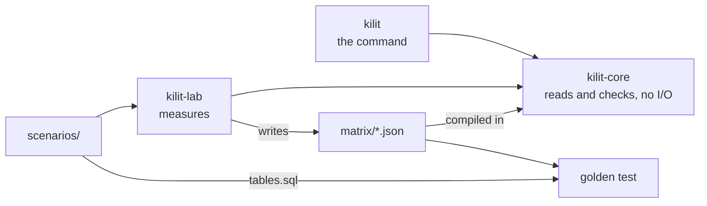
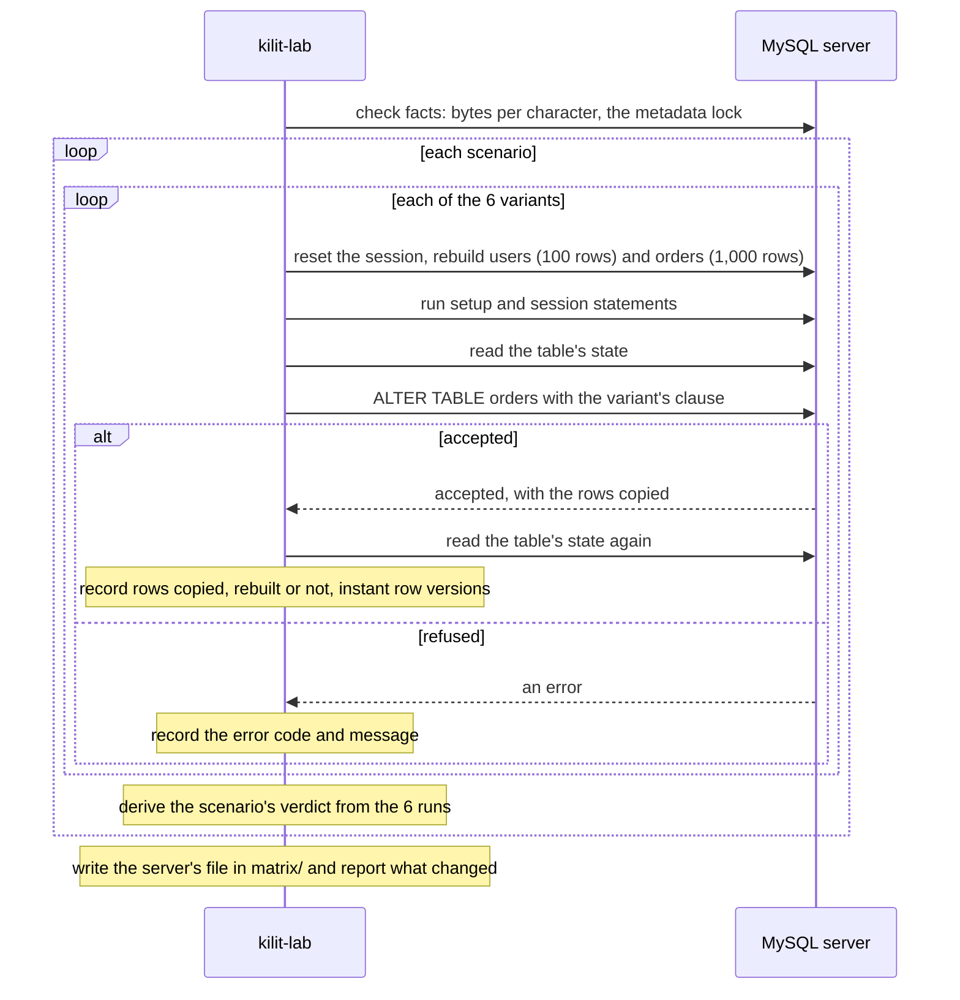
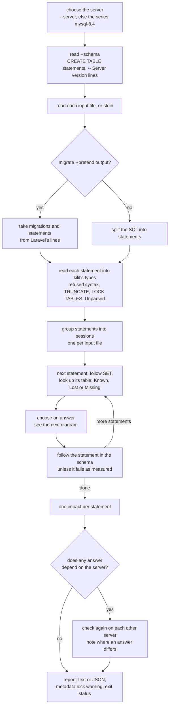
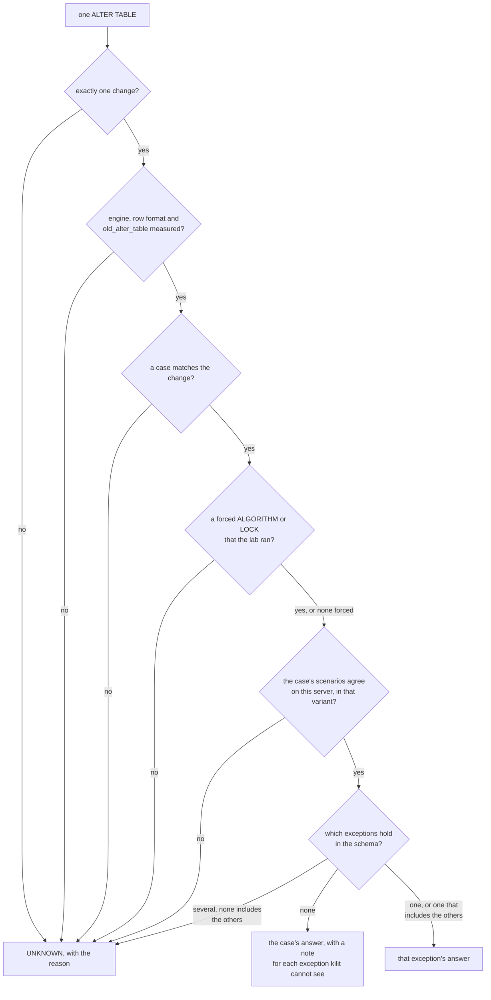

# Architecture

How kilit is built, from the lab that measures to the report that prints.
The terms in italics are defined in the [glossary](#glossary).

- [Crates](#crates)
- [The lab](#the-lab)
- [Reading the input](#reading-the-input)
- [The schema model](#the-schema-model)
- [Sessions](#sessions)
- [The checker](#the-checker)
- [The other-server pass](#the-other-server-pass)
- [Impacts and the exit status](#impacts-and-the-exit-status)
- [Glossary](#glossary)

## Crates

The three crates, and the files that connect them.

- `crates/kilit` is the command: `kilit check` and `kilit servers`. It reads
  files or standard input and prints the report as text or JSON.
- `crates/kilit-core` reads migrations and decides every answer. It does no
  I/O: it takes text and returns data. The lab's results are compiled into it
  from `matrix/*.json`, so checking needs no database. It is the engine of
  kilit, not a library, and its API may change in any release.
- `crates/kilit-lab` measures scenarios on real MySQL servers and writes
  `matrix/`.
- `scenarios/` holds one TOML file per measured change, and the lab's tables.
- `matrix/` holds the lab's results, one JSON file per server release.
- `compose.yaml` starts the MySQL servers the lab runs against.

No crate of the workspace is published to crates.io.

## The lab

How kilit-lab measures one server: the facts first, then each scenario six
times, each run on freshly built tables.

**The fixture.** Every run starts from the same two tables, `users` (100
rows) and `orders` (1,000 rows), defined in `scenarios/tables.sql` and filled
by `crates/kilit-lab/src/fixture.rs`. The lab drops and recreates a database
named `kilit_lab` for every run.

**The six variants.** The lab runs the scenario's change as written, then with
`ALGORITHM=INSTANT`, `ALGORITHM=INPLACE`, `ALGORITHM=INPLACE, LOCK=NONE`,
`ALGORITHM=COPY` and `LOCK=NONE`.

**What a run records.** Whether the server accepted the statement or which
error it returned; how many rows it copied, from the server's reply; whether
InnoDB rebuilt the table, seen as a new table id; and InnoDB's count of
instant column changes. A scenario can make `orders` a MyISAM table. MyISAM
has no table id and no row versions, so the lab reads a copy from the server's
count of `copy to tmp table` stages.

**The verdict.** From the six runs the lab derives the verdict: the algorithm
the server picks when nothing is forced, checked against the run as written,
whether the table is rebuilt or copied, and whether writes can continue. When
a scenario sets `old_alter_table`, the lab takes the algorithm whose forced
run did exactly what the run without a clause did.

**The facts.** Before the scenarios, the lab checks what kilit uses without a
scenario of their own, once per server: how many bytes a character takes in
each character set, and that an `ALTER TABLE` waits for a transaction that
has read its table and is still open, with `ALGORITHM=INSTANT`, `INPLACE` and
`COPY` alike, while a plain `SELECT` from another connection waits behind it.
For the lock, the lab uses a wait of 3 seconds for the `ALTER` and 1 second for
the read, and reads the default `lock_wait_timeout`, 31536000 seconds.

**The matrix.** The results go to `matrix/`, one JSON file per server release.
They hold no timestamps or ids, so a file changes only when a server behaves
differently, and the lab reports which scenarios changed.

## Reading the input

`kilit-core` reads in three steps.

- `split.rs` splits SQL into statements at semicolons, as the `mysql` client
  does, so a semicolon inside a string or a comment does not end one.
- `pretend.rs` reads the output of `php artisan migrate --pretend`, which kilit
  recognizes on its own. See [Laravel](laravel.md#how-the-output-is-read).
- `parse.rs` reads each statement with
  [sqlparser](https://crates.io/crates/sqlparser)'s MySQL dialect into kilit's
  own types, in `statement.rs`. Only `parse.rs` touches sqlparser's types.

Nothing is dropped silently, with one exception: a statement made only of a
`/*! */` comment is skipped (see [limitations](limitations.md#input)). An
operation kilit reads but does not model becomes `Other`. A statement it
cannot read becomes `Unparsed`, with a reason, without stopping the statements
after it. Syntax that MySQL 8.0.46 and 8.4.13 reject is `Unparsed`, and so are
`TRUNCATE` and `LOCK TABLES`. kilit never says that rejected syntax fails with
error 1064, because the lab has no fact for it.

An `ALTER TABLE` made only of table options (`COMMENT`, `ENGINE`, `ROW_FORMAT`,
`KEY_BLOCK_SIZE`) is read by a reader of kilit's own, because sqlparser cannot
read all of them.

## The schema model

The schema comes from `CREATE TABLE` statements, such as a schema dump, with
each table's engine and row format. `schema.rs` follows every statement of the
migration through it: columns, indexes, foreign keys and CHECK constraints are
added, changed, renamed and dropped, so each statement is judged against the
tables as they are at that point.

Each table is in one of three states:

- *Known*: kilit has its definition.
- *Lost*: kilit stopped trusting it, with a reason, because a statement changed
  it in a way kilit cannot follow, such as one it cannot read.
- *Missing*: kilit never saw the table, for example without `--schema`.

A failure comes from the statement itself (error 1674 for an expression
default, or the error of a forced `ALGORITHM` or `LOCK` that MySQL refuses), or
from a Known table whose schema shows the cause. A cause that no schema shows,
or that a Lost or Missing table hides, becomes a note, never a failure.

A statement that fails as measured does not change the schema. Any other
answer applies the statement. An `UNKNOWN` statement is followed as if it ran,
or loses its table when kilit cannot read it.

## Sessions

Each input file, and standard input, is a *session* of its own, as `mysql <
a.sql` and `mysql < b.sql` are. `foreign_key_checks`, `sql_log_bin` and
`old_alter_table` start from the MySQL defaults in each file, and a note names
the earlier file's `SET`. After a `SET GLOBAL` or `SET PERSIST` in an earlier
file, the setting is unknown in the later ones. The tables carry over, except
temporary tables. A `--pretend` file is one session, whatever migrations it
holds. The scans for `binlog_format`, `sql_mode` and similar settings cross
files.

## The checker

What `kilit check` does with its input, in the order the code runs it.

The checker places each change in a *case*: a kind of change, together with
the lab scenarios that measured it. There are 28 cases for InnoDB, and 46 more
for MyISAM, row formats and `old_alter_table`. For a `MODIFY` or `CHANGE`,
`modify.rs` compares the new definition with the column's current one,
character set and collation included, and the one thing that changes decides
the case. The scenarios of a case must agree on each server, or kilit refuses
to answer.

A case can have *exceptions*: the same change measured in a situation where the
answer differs. Each exception has *conditions*. When the situation shows in
the schema, such as a FULLTEXT index on the table or a foreign key on the
column, the exception decides the answer. When it does not, such as rows that
break a new constraint, it becomes a note.

When several exceptions hold, the one whose conditions include all the others'
wins. If none does, the answer is `UNKNOWN`. The order of the list never
decides.

A statement that forces `ALGORITHM=...` or `LOCK=NONE` is answered from the
lab's run of exactly that variant.

How the checker chooses the answer for one `ALTER TABLE`; every "no" ends in
`UNKNOWN` with a reason that says what is missing.

Session statements are followed in order. `foreign_key_checks` and
`old_alter_table` change the answers of the statements after them; `sql_log_bin
= 1` keeps them. `binlog_format`, `innodb_default_row_format`,
`innodb_strict_mode`, `default_storage_engine` and
`restrict_fk_on_non_standard_key`, once named, make `UNKNOWN` the answers they
could change, and `sql_mode` does so for a MyISAM key that may be too long.
See [what kilit does with each setting](findings.md#server-settings-the-lab-measured-with).

## The other-server pass

The exit status follows the server you check against. When another measured
server answers a statement differently, a note says so, for example `on
mysql-8.0.46: fails with error 1822`, and the JSON has it in `other_servers`.
The comparison covers the impact, the algorithm, whether the table is rebuilt,
whether rows are copied, whether writes continue and the error.

The pass runs only when the input touches a scenario that differs between the
servers, or a code path that depends on the server (today,
`restrict_fk_on_non_standard_key`). Each server follows its own schema
timeline. When the other server creates the table earlier in the input, the
note adds that the table is created earlier in these migrations, so nothing
waits for it. Debug builds check the shortcut on every run.

## Impacts and the exit status

Each statement ends with one *impact*: `Fails`, `WritesWait`,
`WritesContinue`, `NewTable`, `Unknown` or `NotChecked`. `NewTable` is a
statement that changes a table created earlier in the same input: no existing
rows are touched, so nothing waits for it. `NotChecked` covers `CREATE TABLE`,
`DROP TABLE`, `SET`, and statements that read or write rows; `RENAME TABLE`,
`TRUNCATE` and `LOCK TABLES` are `Unknown`. The exit status follows from the
impacts and from `--fail-on`; see
[In CI](../README.md#in-ci) for the statuses.

The metadata lock warning is printed once and names the existing tables the
input alters. It covers `ALTER TABLE`, `CREATE INDEX` and `DROP INDEX ... ON`.

## Glossary

| Term | Meaning |
| --- | --- |
| statement | one SQL statement of the input, or one line of `--pretend` output |
| scenario | one TOML file in `scenarios/`: a change the lab measures |
| variant | one of the six ways the lab runs a scenario: as written, with each forced algorithm, and with `LOCK=NONE` |
| verdict | what the lab derives from the six runs of one scenario on one server |
| case | a kind of change, with the scenarios that measured it; its id is in `check.rs` |
| exception | the same change measured in another situation, with conditions |
| condition | a fact about the table that decides whether an exception holds |
| impact | the one word kilit gives each statement: fails, writes wait, writes continue, new table, unknown, not checked |
| answer | what kilit prints for a statement: algorithm, rebuild, copy, writes, or the error |
| Known, Lost, Missing | the three states of a table in the schema model |
| session | the statements of one input file, with the settings they set |
